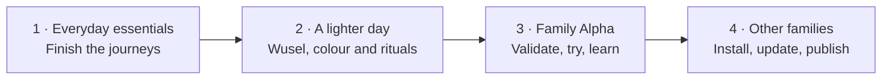

# 13 — Roadmap

Updated 2026-10-25. One build order, four milestones. This replaces the overlapping
M1/M2 and R1–R4 schedules; the old identifiers remain only to keep specification links
and decisions readable. [16 — Build plan](16-setup-plan.md) describes the next slices;
[23 — After the Alpha](23-roadmap-after-alpha.md) holds the later candidates and cut lines.

## Current qualification status

**Core features and “A lighter day” are built; the family Alpha is next after the
remaining journeys.** Shopping with an offline outbox, tasks and points, calendar and
presence, school timetables and import, meals, onboarding, household settings and the
week board exist in code. Shortcuts, ICS subscriptions, local reminders and the packing
reminder are also built. They are not new milestones. **MCP and AI assistants are on hold**
(2026-10-24), removed from the app UI, with their backend and design retained in the
[deferred-work record](deferred/mcp-and-ai-assistants.md). They are not Alpha or release gates.

Member, family, device and shopping-structure editing (old step 10.1–10.3) and Today’s
guardian approvals (10.5, #127/#149) are built.
Cache qualification fixes followed on 2026-10-25: discovery and household recovery after
reconnect/resume, late-response guards, member/holiday invalidations, Today refresh and
midnight rollover, and subscribed-calendar horizon/timezone re-expansion. These do not
complete the offline cold-start or native two-device evidence gates.
A lighter day ([ADR-020](adr/ADR-020-a-lighter-day.md)) was built 2026-10-24 and shipped in
app v1.3.0 and server release 0.4.0; the remaining illustrations, holiday ribbon,
tradition meal suggestions and ritual refinements followed the same day, as its
[amendment](adr/ADR-020-a-lighter-day.md#amendment-2026-10-24-built) records.
The [release checklist](release-checklist.md) exists; executing it is still open.
Issue [#117](https://github.com/wuselwall/wuselwall-app/issues/117) records Android demo
checks and iOS-targeted widget regressions, including Settings navigation. It does not
establish native iOS behaviour, real authentication or two-device synchronization.

“Built” describes repository implementation. It does not establish a deployed server,
working store distribution or a successful pilot. DE/EN/FR/ES application/server text,
installation-selected email language and all four family guides remain the language scope.

## The roadmap at a glance

| Order | Milestone | Status | Done when |
|---|---|---|---|
| **1** | [**Everyday essentials**](https://github.com/wuselwall/wuselwall-app/milestone/1) | Now | A family can start without SMTP, guardians see approvals, the wall starts offline, and onboarding and wide-screen navigation have no remaining dead ends |
| **2** | [**A lighter day**](https://github.com/wuselwall/wuselwall-app/milestone/2) | Built; native qualification open | Wusel, colour, ambience, birthdays and all five agreed rituals work together, with accessible motion and controls |
| **3** | [**Family Alpha**](https://github.com/wuselwall/wuselwall-app/milestone/3) | After 1–2 | Candidate checks pass, the household completes two weeks of everyday use, blockers are fixed and every new delight has a keep/change/remove verdict |
| **4** | [**Ready for other families**](https://github.com/wuselwall/wuselwall-app/milestone/4) | After the Alpha | Another household can install and update safely, compatibility and security checks pass, and the store, legal and publication gates are complete |

The [pinned roadmap](https://github.com/wuselwall/wuselwall-app/issues/125) links all
14 work issues to these milestones. No due dates are promised. Within a milestone, work
follows the dependency order in [16](16-setup-plan.md).

## 1 — Everyday essentials

Old step 10, grouped into four pieces of work:

1. **Start without mail:** discovery, password sign-up/sign-in, guardian-assisted recovery,
   installation defaults and invitations that do not trust an unverified email address.
2. **Approvals on Today — built (#127/#149):** guardian card, Tasks badge and the local
   morning summary. Keep these in regression and native qualification coverage.
3. **Offline cold start:** persist the last wall board and kid day; show their freshness
   and recover when connectivity returns. Shopping retains its existing offline outbox.
4. **Finish the journeys:** resume household setup, single-guardian MFA warning,
   notification-permission progress, wide-screen navigation and review of the existing
   deletion-page/checklist work. Retire old enrolment paths only after the supported
   previous app release no longer needs them.

Member and shopping editing are verification coverage, not new implementation tasks.
The public account-deletion page belongs to the separate website repository; confirm its
content and store URL, and coordinate a separate website change if needed.

## 2 — A lighter day

Old step 11; [ADR-020](adr/ADR-020-a-lighter-day.md) keeps the complete package **before**
the Alpha. **Built 2026-10-24** (app v1.3.0, server 0.4.0), with the remaining pieces
completed later that day: tradition meal suggestions, the Ferien ribbon and module
illustrations, plus the review story, illustrated wishes and birthday refinements.
Native checks (Reduce Motion on a real iPad, sound latency on the tablets, the wall's
idle CPU) belong to the Alpha's qualification.

1. **Foundations and writing:** motion, palette, feedback, settings and content. Q55–Q57
   are decided: Reduce Motion read from the platform's accessibility features, synthesised
   sounds, and the Tischfrage in the header's middle with Vorfreude and the review in the footer.
2. **Wusel:** code-drawn poses, free outfits, short lines, register-specific appearances
   and controls; no mascot in capture, PIN entry or notifications ([25](25-wusel.md)).
3. **Colour and ambience:** module bands, kid cards, celebrations, day phases, occasions
   and OLED pixel shift ([26](26-colour-and-ambience.md)).
4. **Dates to look forward to:** birthdays, countdowns and family traditions, projected
   into the existing calendar and board ([27](27-family-rituals.md)). The read-only month
   view followed on 2026-10-24 (it was never a dependency for birthday projection).
5. **Taking part together:** meal wishes, table questions and the weekly review
   ([27](27-family-rituals.md)). Include export/deletion coverage for the new data.

Q53 was revised later on 2026-10-24: table questions ship in all four languages, with
about 150 questions each in DE/EN and 50 each in FR/ES. The larger FR/ES drafts remain
research material; see [27](27-family-rituals.md#tischfrage). All interface
text, Wusel lines, server responses and guides remain complete in DE/EN/FR/ES.

## 3 — Family Alpha

This is the former M1.6, including the learning and default review formerly split into R1.
It has two steps:

1. **Qualify a candidate.** Use the [release checklist](release-checklist.md): exact-commit
   CI and independent review, signed builds, real authentication and pairing, two-device
   sync, Outlook/iOS feeds, local reminders, native accessibility, offline restart and an
   isolated restore drill. Back up before applying any live migration. Record evidence
   without server identities or secrets.
2. **Use it for two weeks, then act on the findings.** Gather feedback directly from the
   household, fix blockers, recalibrate defaults without overwriting overrides, and judge
   Wusel, colour and each ritual against [25](25-wusel.md#how-the-trial-judges-wusel),
   [26](26-colour-and-ambience.md#how-the-trial-judges-the-colour) and
   [27](27-family-rituals.md#how-the-trial-judges-the-rituals). Tone down, switch off or remove
   the parts that fail their criteria. Reserve capacity for what the trial reveals.

A passed widget suite or a closed implementation issue does not close this milestone.

## 4 — Ready for other families

This combines the old opening gate and R2. The project remains self-hosted only
([ADR-018](adr/ADR-018-self-hosted-only.md)); each operator chooses their own household
creation mode. Public store distribution waits for all three work packages:

| Work package | Required result |
|---|---|
| **Portable, safe server releases** | Current app tested against the previous server release; unsupported versions refused clearly; backup-first updates with failure guidance; server/job/backup status that stays on the family's server; 30-day empty-account cleanup scheduled |
| **An independent household succeeds** | Clean install-to-Today walkthrough with and without SMTP; guide reviewed in all four languages; native accessibility and cross-household security reviewed; export and deletion checked on disposable data, with pilot operations governed by the release checklist |
| **Store and publication readiness** | Honest privacy/Data safety forms, demo access for review, verified mail setup, contact/legal and account-deletion pages, signed release channels, screenshots, docs hosting and separately coordinated website progress; complete [11's legal gate](11-security-and-privacy.md#privacy-and-legal) |

The server kit, guide and discovery already exist. This milestone proves and hardens them;
it does not rebuild them. The four-language guide is now live at [docs.wuselwall.app](https://docs.wuselwall.app/).
Website progress and legacy-link redirects remain a separate operator handoff; see the
[cutover record](website-and-docs-migration.md#activation-status--2026-10-24).

## Later — choose from use

[23](23-roadmap-after-alpha.md) is the single later backlog. Audit history,
automation-origin markers, recipe import and desktop tools are candidates, without a
promised release or due date. MCP/AI assistant setup, consent, scopes and proposals are
parked together in [23's on-hold section](23-roadmap-after-alpha.md#on-hold--mcp-and-ai-assistants).
Push relay, multiple households and
school-portal imports require a real case first. Birthdays are already in milestone 2;
Shortcuts is already built; the retained MCP implementation is deferred.

## Effort

Plan one work package at a time. The old estimates for already-built modules and the
“one or two evenings” launch estimate are retired. The Alpha itself needs **two weeks of
use**, in addition to candidate qualification and follow-up. Estimate remaining code only
after reviewing a package against the current implementation; external store and device
availability do not have a reliable development estimate.

## Milestone discipline

- Keep one active build milestone; start writing the milestone-2 content early if useful.
- Each issue has one outcome and belongs to one milestone. Acceptance criteria are
  checkboxes inside the issue; do not mirror every specification paragraph as an issue.
- New ideas go to [23](23-roadmap-after-alpha.md), unless they fix a blocker for the current
  outcome. Preserve the scope cuts in [05](05-module-calendar.md), [06](06-module-tasks.md),
  [07](07-module-meals-shopping.md) and [15](15-module-school-timetable.md).
- Every slice follows the architecture, localization and compatibility rules in
  [AGENTS.md](../AGENTS.md). Deployable changes follow the backup/update procedure;
  a roadmap issue does not authorize an operation on a family's live data.
- Update GitHub and this plan together. Coordinate public-progress copy separately in
  `wuselwall-website`; app contributions do not require access to that repository.
